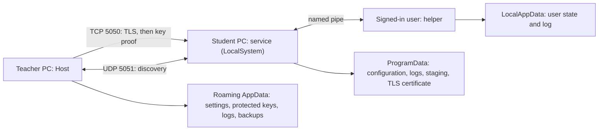

# Architecture

Classroom Manager has two programs that talk over the school network: the **Host**, which a teacher runs, and the **Client**, which runs on each student PC. This page says what the parts are, how they talk, where they keep their data, and which boundaries matter for security. The [threat model](THREAT-MODEL.md) says what we defend against and what we accept.

Describes version 1.2 (protocol 1.21).

## The parts

| Part | Where it runs | What it is |
|---|---|---|
| **Host** | The teacher's PC, as the teacher's Windows account | A WPF application (`ClassroomHost.exe`). The same program also runs scripted commands (`--cli`). |
| **Client service** | Each student PC, as `LocalSystem` | A Windows service (`ClassroomClient.exe --service`). It owns the network port and does the administrative work. |
| **Client helper** | Each student PC, as the signed-in student | The same executable without the service switch, started at sign-in. It does work that needs the student's desktop and shows a visible tray icon, so students can see the computer is managed. |
| **Shared library** | Both | `src/Shared`: the secure channel, the protocol, keys, TLS settings and the translation texts. |
| **Optional modules** | Host | Reporting, browser inventory, automation, software inventory and others under `src/Modules`; the build switches them on or off (`ClassroomModules.props`). |

Ports are configurable. Nothing is sent to a vendor server: management is direct TCP between the teacher's PC and the student PCs. The Host can optionally check GitHub once a day for a newer release notice. Updating the Client programs, installing software or using Windows Update happens only when a teacher asks for it.

## How a command travels

1. The Host connects to the Client's TCP port. **TLS comes first** (1.2 or 1.3 only). The Host connects only to a certificate the teacher has approved by its fingerprint, so a stranger on the network cannot sit in the middle.
2. Inside TLS, the two sides prove they hold the same **key** (a challenge-and-response with HMAC-SHA256 over fresh random values). The proof is tied to the TLS certificate, so it cannot be passed on to a different connection.
3. Every message after that carries a message authentication code that covers its direction and sequence number, so a message cannot be altered, replayed or reflected.
4. The key the Client accepted decides the **role**: Observer, Teacher or Admin. The Client checks the role for every request, not once per connection, so removing a key takes effect at the next request.
5. The service does the work, or hands desktop work (showing a message, a user-level file action) to the helper over a local pipe.

The Client does not open management connections to the Host; it answers the Host's connections (and the discovery questions on UDP).

## Where data lives

| Data | Place | Protection |
|---|---|---|
| Host settings and keys | `%AppData%\ClassroomManager` of the teacher's account | Keys are encrypted with the teacher's Windows account (DPAPI). Up to 30 earlier copies are kept as backups. |
| Client configuration, keys, TLS certificate | `%ProgramData%\ClassroomManager` on the student PC | Readable only by SYSTEM and administrators. The Client sets this on every start. |
| Files being transferred | `Staging` in the same folder | Per-Host areas; the teacher role can only touch its own uploads. |
| Logs | Host: `%AppData%\ClassroomManager\logs`; Client: ProgramData and the user's LocalAppData | Local files. The Client also keeps a tamper-evident chain of security events. |

The programs do not capture or record what is on a student's screen. [PRIVACY.md](../PRIVACY.md) lists what data exists and where.

## Source layout

| Folder | Content |
|---|---|
| `src/Shared` | The protocol, the secure channel, keys, TLS profile, translations. Referenced by both programs. |
| `src/ClassroomHost` | The Host (WPF) and its command-line entry points. |
| `src/ClassroomClient` | The Client service and helper (WinForms). |
| `src/Modules` | Optional Host modules and their contract. |
| `tests` | Tests for the shared library, the Host and the Client. They run in CI on every change. |
| `deploy`, `scripts` | Build, publish and install scripts. |
| `locale` | The translation template and the Lithuanian translation. |

[CONTRIBUTING.md](../CONTRIBUTING.md) says how to build and what a change needs. The build treats warnings, including the .NET security analyzers, as errors, and restores NuGet packages in locked mode from committed lock files.

## Releases

A release is built from a tagged commit by GitHub Actions, signed through the SignPath Foundation after a person approves the request, and published with checksums and a software bill of materials. See [CODE_SIGNING_POLICY.md](../CODE_SIGNING_POLICY.md).
